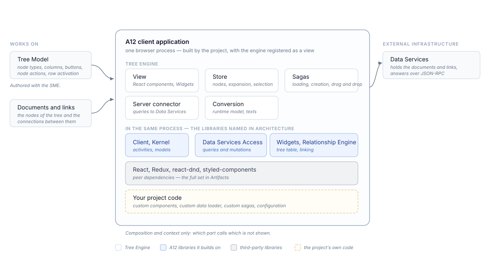

////
SPDX-License-Identifier: EUPL-1.2 OR LicenseRef-commercial
Copyright (c) 2012-2026 mgm technology partners GmbH
Dual License
This source file is part of the mgm A12 Platform and available under a choice of two different licenses:
1. Open-Source License - EUPL v1.2
You may redistribute and/or modify this file under the terms of the European Union Public License, version 1.2 - see https://eupl.eu/.
2. Commercial License
Alternatively, you may obtain a commercial license from mgm technology partners GmbH, that permits use of this software under different terms (including support and maintenance services).

Please contact a12-license@mgm-tp.com for more information.

You must select and comply with exactly one of the above license options.

Warranty Disclaimer (applies to either option)
THIS SOFTWARE IS PROVIDED "AS IS" AND WITHOUT WARRANTY OF ANY KIND, WHETHER EXPRESS OR IMPLIED, INCLUDING BUT NOT LIMITED TO THE WARRANTIES OF MERCHANTABILITY, FITNESS FOR A PARTICULAR PURPOSE AND NON-INFRINGEMENT, EXCEPT WHERE SUCH DISCLAIMERS ARE HELD TO BE LEGALLY INVALID. SEE THE RESPECTIVE LICENSE TEXT FOR DETAILS.
////
[#introduction]
== Introduction

[#functionality]
=== Functionality

Tree Engine is the model-driven hierarchy view of A12 client applications:
it reads a Tree Model and renders documents connected by links as the nodes of a tree, together with the interaction around them.
The model names the node type the tree starts from, whose documents are its root nodes; a modeled virtual root gathers them under one labeled entry instead.
The node types, columns, buttons, node actions, context menu, and row activation are modeled rather than programmed, so a tree changes with its model.

Expanding and collapsing nodes, paging child nodes, and the create, read, update, and delete operations on nodes and on link documents are provided as shipped and modeled in the Tree Model.
Drag and drop is provided as shipped and enabled in the Tree Model; it requires the application to mount a drag-and-drop provider, described in <<installation/drag-and-drop-provider,Installation>>.
Full-text search over the documents of all node types is provided as shipped and enabled in the Tree Model, as <<full-text-search,Full-Text Search>> describes.
Multi-selection, its selection area mode, keyboard shortcuts, the initial expansion, and the starting root node are configurable per application or per activity.
The engine loads and writes its nodes through a data loader that is provided as shipped over A12 Data Services and can be replaced by the project.
It resolves the localized texts of the model and of its own user-interface elements, shipping English and German; further locales are configured in the models or supplied through the localization context, as <<localization,Localization>> describes.
Beyond the modeled surface, projects override rendering, state access, and the requests the engine sends through the extension surfaces named in <<architecture,Architecture>>.

Tree Engine does not edit the documents it shows — that is the Form Engine, which the engine opens as a separate activity — and it does not present flat tables or lists, which is the Overview Engine.
It works only where the documents are connected by relationships;
where they are not, the Overview Engine is the fitting view, and creating or editing the links themselves is the Relationship Engine's screen, which Tree Engine opens the same way.
It does not store or query documents itself:
it builds queries and mutations and hands them to Data Services, which holds the documents and the links and answers them.
It renders with the widgets of the Widgets library rather than providing its own user-interface components, and Tree Models are authored in the Simple Model Editor (SME), not in this engine.

[#architecture]
=== Architecture

Tree Engine is a client-side library that registers itself as a view in an A12 client application;
it has no process of its own and runs inside the application's browser process.
Its parts are the view, a tree of React components built on the tree table of the Widgets library;
the store, a Redux store whose `Events` report what happened in the user interface and whose `Commands` change the state, holding the loaded nodes and the state around them;
the sagas, which carry out the loading, expansion, and node and link mutations;
the server connector, which turns the engine's queries and mutations into A12 Data Services requests and maps the responses back;
and the conversion of the Tree Model into the runtime model the engine works on, together with the localization of the texts it renders.
It is registered either as an A12 client module or, through an experimental surface, by wiring its factories individually, as <<installation,Installation>> describes.

.Tree Engine overview

On the default path the engine derives what it requests from the model rather than from client code:
the modeled columns determine the field projection, so only the fields a tree displays are fetched, and child nodes are loaded page by page, bounded by a page-size limit the application configures to match its Data Services instance.
Data Services also decides the order of newly added links unless the application configures a position.
The engine knows nothing about authorization: it neither filters nodes nor hides actions by permission, so a project needing either implements it.

The extension surfaces reach from a single rendered component to the whole data path:
the widget map, the component map, and the event handlers dispatch map for rendering and interaction, the selector map for state access, experimental, and the request selector map for the queries and mutations, a custom data loader, the registration of the default sagas, the view context's row, drag-and-drop, and keyboard-shortcut callbacks, and the two factories' module settings.
The detail chapters document each surface.

Document Models, document services, and model access come from the Kernel model facade;
the queries and mutations are built with the Data Services access library;
the application frame, the view registration, and the activity handling come from Client;
the tree table and the form controls come from Widgets;
and the linking of created documents is coordinated with the Relationship Engine.
The platform context reaches the engine as peer dependencies (see <<artifacts,Artifacts>>).

[#artifacts]
=== Artifacts

The package a project declares in its build — not the full set of published modules (npm scope `@com.mgmtp.a12.treeengine`, ECMAScript modules):

[cols="2,3"]
|===
| Artifact | Purpose

| `treeengine-core`
| The engine: the view, the store, the sagas, the server connector, the model conversion and localization, and the configuration maps.
|===

`treeengine-core` declares its platform context as peer dependencies, provided by the consuming application:
Client with its Redux action compatibility layer, the Kernel runtime API and model facade, Data Services access, Relationship Engine, Widgets, the Base model API, the Utils libraries for connection, localization, React localization, and logging, and the rendering stack of React, React DOM, react-dnd, Redux, react-redux, redux-saga, typed-redux-saga, and styled-components.

[#technologies]
=== Technologies

On the React and Redux stack it declares as peer dependencies (see <<artifacts,Artifacts>>), it adds:

* JSON-RPC as the protocol to A12 Data Services — the engine requires `mgmtp.a12.dataservices.jsonRpc.enabled` on the Data Services instance, as <<installation,Installation>> describes.
* `redux-saga` with `typed-redux-saga` for the asynchronous loading, expansion, and mutation flows, and `reselect` for the memoized selectors over the store.
* `react-dnd` for the drag-and-drop interaction, mounted by the application as a drag-and-drop provider.
* `keycode-js` for the key resolution behind the keyboard shortcuts.

[#terminology]
=== Terminology

[cols="1,3"]
|===
| Term | Meaning

| Node
| One row of the tree, corresponding to one document — reached over a link, except at the roots of the tree.

| Tree Model
| The model defining a tree: its node types, columns, buttons, node actions, context menu, drag and drop, and row activation.
  Authored in the SME.

| Identifier
| The pair of document ID and document name by which the engine distinguishes the documents and links of a tree.

| Node path
| The array of identifiers locating a node — the identifier of the root node it starts from, followed by the identifiers of the links leading to it.

| Row activation
| The modeled behavior of a click on a node — raising an event, inserting a node, or nothing.

| Hidden root node
| A root entry given by a relationship with an explicit source, so that a tree shows the subtree under a document without showing that document as a row.

| Configuration maps
| The named maps through which a project replaces what the engine renders and how it reads state and builds requests — the widget map, the component map, the event handlers dispatch map, the experimental selector map, and the request selector map.

| Server connector
| The part of the engine that turns its queries and mutations into A12 Data Services requests and maps the responses back to nodes, registered as `TreeEngineServerConnectorFactories` — not the platform's Utils server-connector library.
|===
