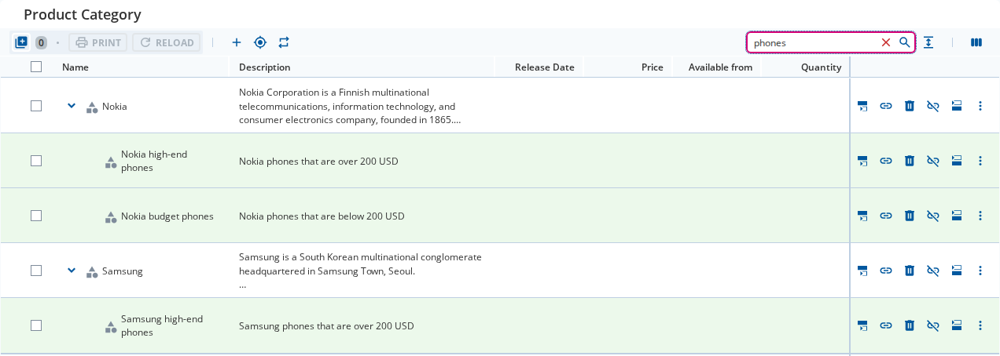
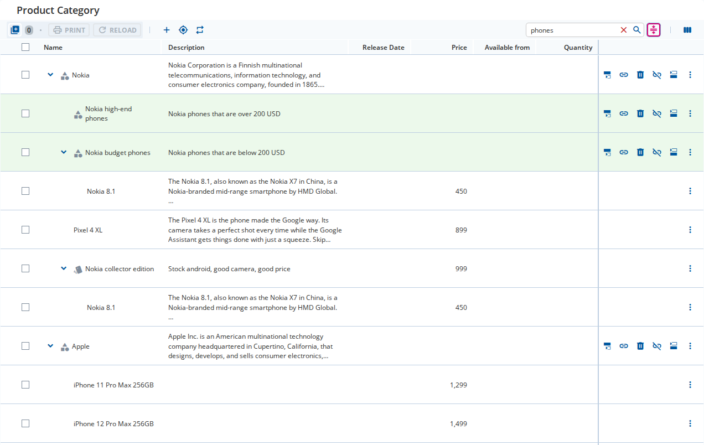

////
SPDX-License-Identifier: EUPL-1.2 OR LicenseRef-commercial
Copyright (c) 2012-2026 mgm technology partners GmbH
Dual License
This source file is part of the mgm A12 Platform and available under a choice of two different licenses:
1. Open-Source License - EUPL v1.2
You may redistribute and/or modify this file under the terms of the European Union Public License, version 1.2 - see https://eupl.eu/.
2. Commercial License
Alternatively, you may obtain a commercial license from mgm technology partners GmbH, that permits use of this software under different terms (including support and maintenance services).

Please contact a12-license@mgm-tp.com for more information.

You must select and comply with exactly one of the above license options.

Warranty Disclaimer (applies to either option)
THIS SOFTWARE IS PROVIDED "AS IS" AND WITHOUT WARRANTY OF ANY KIND, WHETHER EXPRESS OR IMPLIED, INCLUDING BUT NOT LIMITED TO THE WARRANTIES OF MERCHANTABILITY, FITNESS FOR A PARTICULAR PURPOSE AND NON-INFRINGEMENT, EXCEPT WHERE SUCH DISCLAIMERS ARE HELD TO BE LEGALLY INVALID. SEE THE RESPECTIVE LICENSE TEXT FOR DETAILS.
////
[#full-text-search]
=== Full-Text Search

The search bar lets end users find nodes of every type by a term.
The term is matched against all fields of a node's own document; fields of link documents are not searched.
Matching is done by Data Services with `simple_search`, one query per document model that the tree's nodes are built on.

Search is offered for the `tree` expansion strategy only.
With `level_by_level`, the search element renders nothing.

==== Configuration

[cols="1,1,3"]
|===
| Property | Type | Description

| `configuration.showFullTextSearch`
| `boolean`
| Enables the feature. Unset by default, so existing models are unaffected. Without the search element below, nothing renders.

| `search` element in `subHeaderBox`
| `ElementType`
| Places the search bar in the left or right slot; either one works. Without the flag above, nothing renders.

| `configuration.searchResultViews`
| `Array<"reduced" \| "complete">`
| The result views a search offers. Defaults to both. With a single entry, the tree always shows that view and the view switch is hidden.
|===

[source,json,options="nowrap",title="Tree Model"]
----
{
  "content": {
    "configuration": {
      "expansionStrategy": { "type": "tree" },
      "showFullTextSearch": true,
      "searchResultViews": ["reduced", "complete"]
    },
    "subHeaderBox": { "rightSlot": [{ "type": "search" }] }
  }
}
----

[#full-text-search-behavior]
==== Behavior

A search starts when the user presses kbd:[Enter] or clicks the search button.
Typing alone does not search.
The clear button ends the search, and so does submitting an empty term.

A search sends two requests: the search queries, then a tree load from the root, deep enough to contain every match.
The ancestors of each match are expanded; the match itself stays collapsed.
Matched rows are highlighted.

The two result views show the same loaded tree, so switching between them sends no request:

* `reduced` shows only the matches and the nodes on the path to a match. This is the view a search opens in whenever the model offers it.
* `complete` shows the whole tree with the paths to the matches expanded.

[title="Reduced view: the matches for \"phones\" and the nodes on the path to them"]

[title="Complete view: the whole tree, with the matches highlighted"]

While the reduced view is active, expand and collapse of the whole tree and of a subtree are disabled, including their keyboard shortcuts.
When the reduced view keeps no node, the body shows a "no results" message instead of the rows.

A term the user submits resets the result view to its default and clears the selection and the multi-selection.
Clearing the search does the same, and reloads the tree to the depth it is currently loaded to; expanded nodes stay expanded.

While a search is active, an edit (add, delete, move, paste, or a node created in a form) and a reload of the tree re-run the search with the current term.
A re-run keeps the result view and the selection.

In small view the sub-header is not rendered.
A search button in the heading then shows or hides the search bar below the heading.

==== Prerequisites and Limits

* The minimum term length comes from the Data Services setting `mgmtp.a12.dataservices.query.simpleSearch.minSearchableTokenSize`.
A shorter term disables the search button, shows the minimum length as its tooltip, and ignores kbd:[Enter].
* Each search query returns one page of matches per document model.
The page size is `maximumPageSize` of the data loader setting, or 100 when it is unset; matches beyond the first page are not found.
* A match can be in a field that the tree does not display. The row is still shown and highlighted.
* If no node type of the tree has a searchable document model, a warning notification is shown instead of a search.
* A failed search dispatches `ActivityActions.error` with a `TreeEngineError.SearchError` (error code `SEARCH_ERROR`), see <<error-handling,Error Handling>>.

[#full-text-search-events]
==== Event Handlers

The following handlers are registered in `eventHandlers` of the Tree Engine:

[cols="1,1,2"]
|===
| Handler | Parameters | Called when

| `onSearchQueryChanged`
| `{ searchTerm }`
| The user submits or clears a term. An empty term clears the search.

| `onSearchResultViewChanged`
| `{ view }`
| The user switches between the reduced and the complete view.

| `onMobileSearchBarToggle`
| `{ visible }`
| The user shows or hides the search bar in small view.
|===

[WARNING]
====
Supplying a handler *replaces* the engine's own dispatch.
Forward the event as `Events.onSearchQueryChanged({ searchTerm, trigger: "user" })`, `Events.onSearchResultViewChanged({ view })` or `Events.onMobileSearchBarToggle({ visible })`, otherwise the search no longer runs.
====

The search runs in the saga `watchSearchSaga`, which is registered by default.
It reacts to link:./assets/generated/typedoc/variables/core_store.Events.onSearchQueryChanged.html[Events.onSearchQueryChanged], so dispatching this event is also how an application starts or clears a search from code.

[#full-text-search-state]
==== Reading and Setting the State

link:./assets/generated/typedoc/functions/core_store.UIStateSelector.searchString.html[UIStateSelector.searchString], link:./assets/generated/typedoc/functions/core_store.UIStateSelector.matchedNodes.html[UIStateSelector.matchedNodes], link:./assets/generated/typedoc/functions/core_store.UIStateSelector.searchResultView.html[UIStateSelector.searchResultView] and link:./assets/generated/typedoc/functions/core_store.UIStateSelector.showMobileSearchBar.html[UIStateSelector.showMobileSearchBar] read the search state.

link:./assets/generated/typedoc/variables/core_store.Commands.setSearchResult.html[Commands.setSearchResult], link:./assets/generated/typedoc/variables/core_store.Commands.setSearchResultView.html[Commands.setSearchResultView] and link:./assets/generated/typedoc/variables/core_store.Commands.setShowMobileSearchBar.html[Commands.setShowMobileSearchBar] write it.

[NOTE]
====
`Commands.setSearchResult` only writes the term and the matches to the store.
It does not send a request and does not change the loaded tree.
To run a search, dispatch `Events.onSearchQueryChanged`.
====

[#full-text-search-customization]
==== Customization

The search user interface is built from these entries of the link:./assets/generated/typedoc/interfaces/core_view.ComponentMap.html[ComponentMap]:

* `SearchBar` is the search input in the sub-header.
* `SearchResultViewToggle` is the button beside the search bar that switches the result view. It is shown only while a search is active and the model offers both views.
* `SearchButton` is the heading button that toggles the search bar in small view.
* `MobileSearchBar` is the row below the heading that holds the search bar in small view.
* `EmptySearchResultBody` is the body shown when the reduced view keeps no node.

A replaced `Body` can call link:./assets/generated/typedoc/functions/core_view.useTreeBodyState.html[useTreeBodyState] to tell an empty search result (`"empty-search-result"`) from an empty tree.

A custom data loader has to answer queries of type `SEARCH_NODES` (link:./assets/generated/typedoc/interfaces/extensions_server-connector.DataOperation.Query.SearchNodes.Query.html[DataOperation.Query.SearchNodes.Query]).
The default data loader builds the request with `searchNodes` of the request selector map, see <<request-selector-map,Request Selector Map>>.
